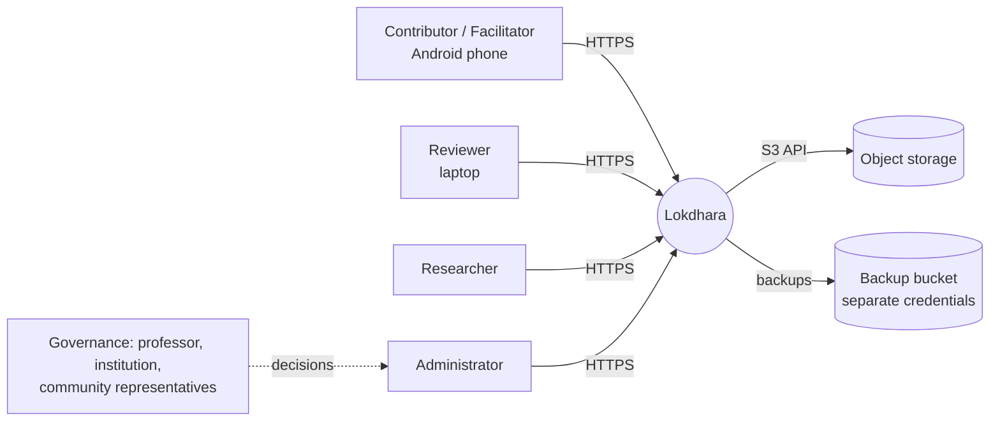
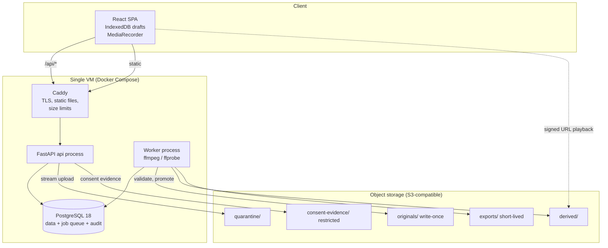
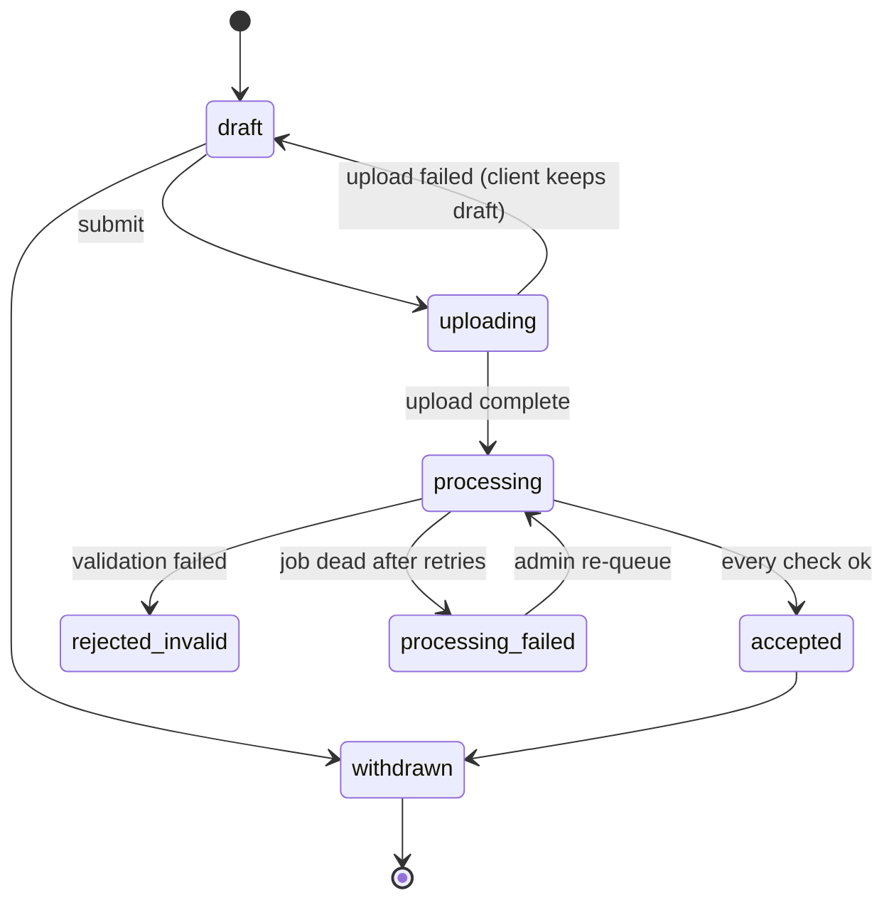
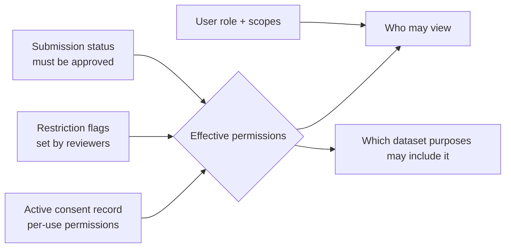
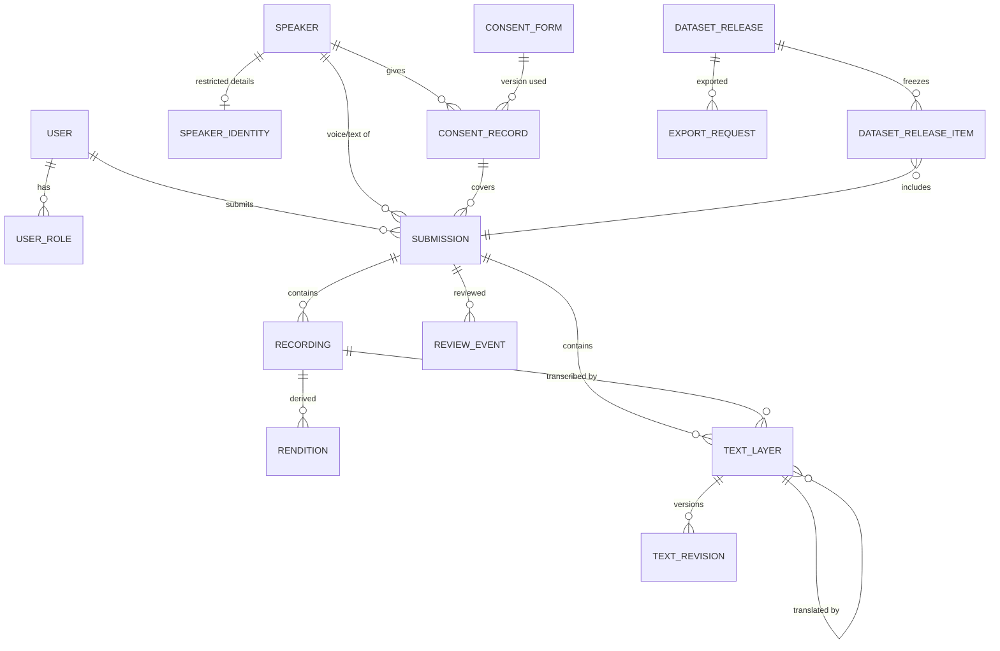
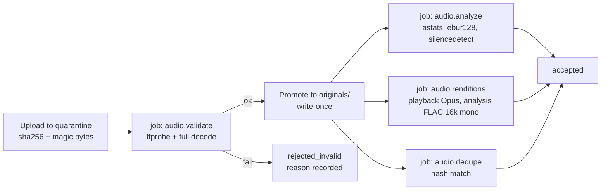

# Architecture Diagrams

All diagrams are Mermaid and render on GitHub. They describe the **proposed** architecture in [SYSTEM_ARCHITECTURE.md](SYSTEM_ARCHITECTURE.md).

## 1. Context

## 2. Containers

## 3. Submission state machine

There is no human review step ([ADR-021](ARCHITECTURE_DECISIONS.md#adr-021--no-human-reviewer-accept-after-automatic-checks-keep-text-unverified)). The statuses `awaiting_review`, `in_review`, `changes_requested`, `approved` and `rejected` are still allowed by the database but unused, kept for later peer checking. An admin hides a reported item with a restriction flag, not a status.

`uploading` happens on the device: the server keeps a submission in `draft` while its recording uploads, and `submit` moves it straight to `processing` (docs/API_SPECIFICATION.md §4).

Restriction (`sensitive`, `third_party_voice`, `contains_pii`, `culturally_restricted`) is a **separate flag set**, not a state, because an accepted item can also be restricted (hidden).

## 4. Effective access computation

Effective permission = the **most restrictive** of consent, restriction flags, and status. Nothing can widen what the speaker consented to.

## 5. Entity relationships (summary)

Full schema: [DATABASE_SCHEMA.md](DATABASE_SCHEMA.md).

## 6. Processing pipeline

