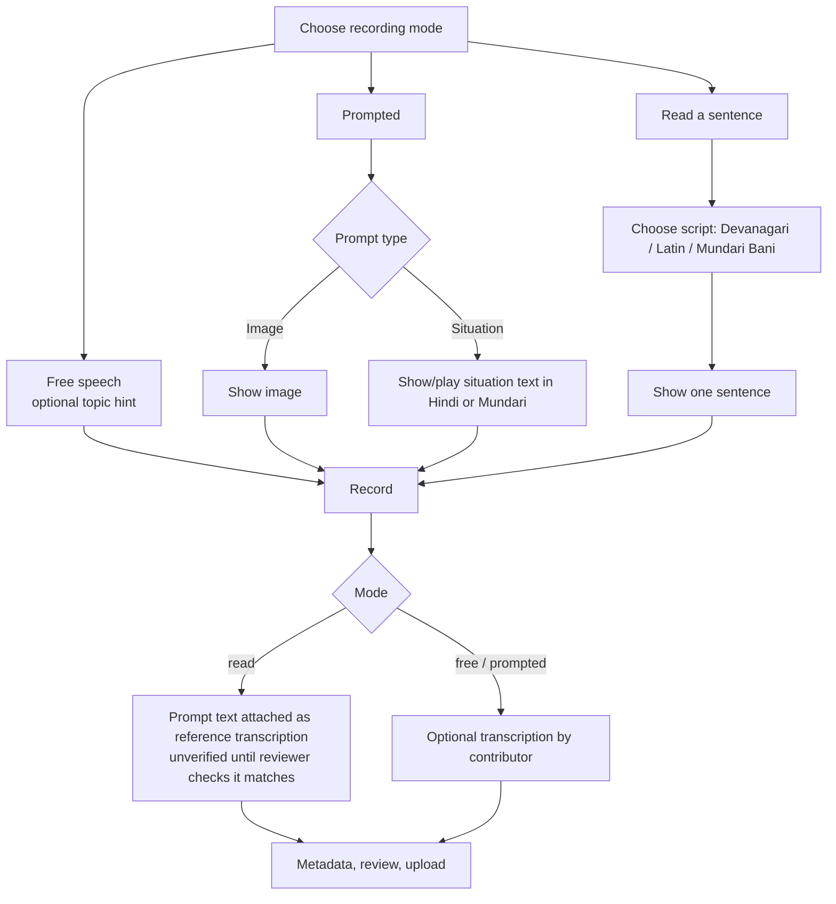

# Recording Modes

Status: **Proposed (owner requested, 2026-10-11).** Decision recorded as ADR-018 in [ARCHITECTURE_DECISIONS.md](ARCHITECTURE_DECISIONS.md).

Every audio contribution is collected in one of three modes. These are the standard ways speech corpora are built:

| Mode | `recording_mode` | What the speaker does | Strengths | Costs | Real-world example |
|------|------------------|----------------------|-----------|-------|--------------------|
| **Free speech** | `free` | Speaks about anything: a story, memory, song, daily life | Most natural language; preserves oral tradition | Needs full transcription afterwards; topics unbalanced | Mozilla Common Voice *Spontaneous Speech* ([announcement](https://www.mozillafoundation.org/en/blog/common-voice-spontaneous-speech/)) |
| **Prompted speech** | `prompted` | Answers a prompt in their own words: describes an **image** or responds to a **situation/question** | Natural but topic-controlled; balanced vocabulary; works for non-literate speakers | Needs a curated prompt library (image rights, cultural review); still needs transcription | Project Vaani collects image-prompted speech across Indian districts ([paper](https://arxiv.org/abs/2603.28714)) |
| **Read speech** | `read` | Reads a displayed Mundari sentence aloud | Transcript known in advance; ideal for speech-technology training and pronunciation data | Only for literate speakers; less natural; needs a reviewed sentence bank in each script | Common Voice read-sentence collection |

Recommended use in the pilot: **prompted** as the default for most speakers, **free** for elders' stories and songs, **read** only for literate contributors who choose it.

## 1. Contributor flow changes

After choosing "Audio" or "Both" (see [USER_FLOWS.md](USER_FLOWS.md) F1), the contributor picks a mode:

- Prompts can be **skipped** ("show another") without penalty.
- Situation prompts can be played as audio for non-literate speakers (prompt audio recorded by the team, stored in `derived/prompts/`, not community data).
- In read mode the reader may misread or change words; the reviewer either verifies the reference text or creates a corrected revision. A reading is never assumed to match the sentence exactly.

## 2. Prompt library

| Field | Notes |
|-------|-------|
| `prompt_type` | `image`, `situation`, `read_sentence` |
| Text | Situation/instruction text in `hi` and/or Mundari; for `read_sentence`, the Mundari sentence plus its `script_code` |
| Image | Object key + **licence and source** (only images the project has rights to: own photos, CC0/CC-BY, or commissioned drawings) |
| Topic tags | e.g. `farming`, `family`, `food`, `festival`, `numbers` (controlled list, Q-X5) |
| Status | `draft` → `approved` → `retired`; only approved prompts are shown |
| Version | Edits create a new prompt version; recordings keep the exact version they used |

Prompt content rules:

- Images: no identifiable faces, no private places, nothing sacred or culturally restricted; reviewed by a community member before approval.
- Read sentences: written or checked by Mundari-literate reviewers; sources must be original or licensed for reuse. Sentences must not contain personal data.
- Situation prompts must not ask for personal information (no "say your address/phone/family names").

## 3. Data model impact (summary)

See [DATABASE_SCHEMA.md](DATABASE_SCHEMA.md) for columns.

- `submissions.recording_mode` (`free` | `prompted` | `read`, NULL for text-only submissions).
- New `prompts` table (versioned, immutable rows per version) and `submissions.prompt_id` FK.
- Read mode creates a transcription layer whose first revision has `origin = prompt_text` and `verification_status = unverified`.
- Exports include `recording_mode` and `prompt_id` (+ prompt text/image reference for released prompts), so researchers can separate read from spontaneous speech.

## 4. Open questions

- Q-X5: topics and initial prompt sets (linguist + community).
- Q-X6: source of the read-sentence bank and its licence (new).
- Q-G7: who approves images and situation prompts for cultural appropriateness (new).
